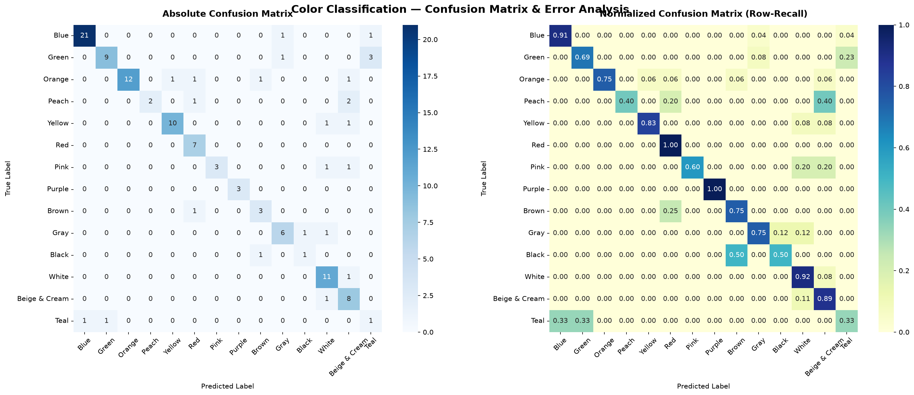

# 🎨 Color Classification with KNN — Bilingual Persian/English

[](https://www.python.org/)
[](https://scikit-learn.org/)
[](https://github.com/kopolart/knn-color-classification/actions/workflows/ci.yml)
[](LICENSE)
[](https://creativecommons.org/licenses/by/4.0/)

> **A Two-Stage Hierarchical Color Classification System using K-Nearest Neighbors**<br>
> *پروژه جامع داده‌کاوی: طبقه‌بندی هوشمند رنگ‌ها با الگوریتم KNN به زبان فارسی و انگلیسی*

**Dataset:** [KopolArt Color Collection](https://kopolart.ir/colors) — curated by **Ali Yousefi (KopolArt)**, licensed under **CC BY 4.0**.<br>
**Required attribution:** **کپل‌آرت – Ali Yousefi** + a direct link to <https://kopolart.ir/colors>. See [data/README.md](data/README.md) for details.

---

## 📑 Table of Contents

- [Project Overview](#-project-overview)
- [Results](#-results)
- [Why Two Stages?](#-why-two-stages)
- [Dataset](#-dataset)
- [Repository Structure](#-repository-structure)
- [Quick Start](#-quick-start)
- [Reproducibility](#-reproducibility)
- [Feature Engineering](#-feature-engineering)
- [Two-Stage Inference Pipeline](#-two-stage-inference-pipeline)
- [Confusion Matrix](#-confusion-matrix)
- [Notebooks](#-notebooks)
- [Requirements](#-requirements)
- [Key Concepts](#-key-concepts)
- [Citation](#-citation)
- [License](#-license)
- [Contributing](#-contributing)
- [Contact](#-contact)
- [Acknowledgements](#-acknowledgements)

---

## 📌 Project Overview

Given any RGB hex code (e.g. `#388E3C`), this project predicts the **full bilingual color name** in both English and Persian using a **Two-Stage Hierarchical KNN** approach:

| Stage | Method | Output |
|-------|--------|--------|
| **Stage 1** | K-Nearest Neighbors on cylindrical HSV + RGB features | Base color family (e.g. `Green` / `سبز`) |
| **Stage 2** | Nearest-neighbor search in perceptual CIE L\*a\*b\* space | Exact shade name (e.g. `Dark Green` / `سبز تیره`) |

The dataset contains **608 color samples**, **313 unique English shade names** (331 unique Persian names), and **33 base color families**. Many shades appear only once or twice, so exact-name classification is extremely sparse.

---

## 📊 Results

Metrics are measured on the held-out 20% test split (`random_state=42`) of the main pipeline. Definitions:

- **Strict exact match** — predicted English shade name equals the true shade name.
- **Human-vision** — true and predicted names map to the same core color family (e.g. `Dark Red` vs `Red`).
- **Stage 1 base accuracy** — correct prediction of the 33 `Base_English` families.

| System | Strict exact match | Human-vision Top-1 | Human-vision Top-3 |
|---|---:|---:|---:|
| Single-stage fine KNN, K=5, 6-D features (313 shade classes) — baseline | **17.2%** | **75.4%** | **89.3%** |
| Single-stage 1-NN in CIE Lab — controlled ablation (no family filter) | **12.3%** | **81.1%** | **92.6%** |
| Stage 1 base KNN (33 color families) | — | — | — *(base accuracy: **59.8%**)* |
| **End-to-end two-stage pipeline** (Stage 1 KNN + CIE Lab retrieval) | **12.3%** | **79.5%** | **80.3%** |

**How to read this:** the two-stage pipeline improves human-vision Top-1 accuracy by **+4.1 points** over the 6-D fine-KNN baseline (75.4% → 79.5%). It does **not** beat that baseline on strict exact match or Top-3. Because the baseline and the pipeline differ in both feature space and neighbour count, the CIE Lab 1-NN row is the controlled ablation: it uses the same retrieval space as Stage 2 but searches the whole training set, with no family filter. It reaches **81.1% / 92.6%**, so the Stage 1 restriction does not by itself improve retrieval accuracy on this split. Its benefit is an interpretable, family-consistent decision path with an explicit failure mode — when Stage 1 selects the wrong family, Stage 2 cannot recover. Exact-shade naming remains the hard part of this problem.

> The beginner-friendly notebook reports **Stage 1 base-family accuracy** of **61.48%** (Top-3: **79.51%**) and end-to-end exact-shade accuracy of **14.75%** (Top-3: **29.51%**). Against a fair single-stage 1-NN baseline in the same raw-RGB retrieval space (**11.48%** / **31.15%**), the two-stage restriction gains +3.27 points on exact Top-1 but loses 1.64 points on Top-3. These are different targets from the 313-class fine-KNN row above; see [Notebooks](#-notebooks).

---

## 🔍 Why Two Stages?

The core challenge is **class sparsity**: 608 samples spread over 313 shade names. A naive single-stage KNN treats `Dark Red` and `Red` as completely different classes, so a near-miss is recorded as a total error.

The two-stage design separates the problem into:

1. **Coarse family prediction (33 classes)** — much easier and more stable than 313-way classification.
2. **Fine shade retrieval within the predicted family** — uses perceptual CIE Lab ΔE distance to return the closest available bilingual name.

This coarse-to-fine decomposition makes the decision path interpretable and the failure mode explicit: when Stage 1 selects the wrong family, Stage 2 cannot recover the correct shade. Whether the restriction improves accuracy depends on the feature space; the controlled ablation in [Results](#-results) compares it against the same 1-NN retrieval without the family filter.

---

## 🗂️ Dataset

The dataset is the **KopolArt Color Collection**, curated by **Ali Yousefi (KopolArt)**:

- **Source:** <https://kopolart.ir/colors>
- **License:** [CC BY 4.0](https://creativecommons.org/licenses/by/4.0/)
- **Required attribution:** **کپل‌آرت – Ali Yousefi** + direct link to <https://kopolart.ir/colors>
- **Files:** `data/colors-raw.csv` (608 rows × 3 columns) and `data/colors.csv` (608 rows × 18 columns)
- **Full schema and reuse terms:** [data/README.md](data/README.md)

The raw file contains only `Persian Name`, `EnglishName`, and `HexCode (24 bit)`. Run `prepare_dataset.py` to regenerate the enriched file with RGB, Hue, HSL, HSV, CIE Lab, and base-family columns.

The code in this repository is MIT-licensed. The dataset is **not** MIT-licensed; it remains under **CC BY 4.0**.

---

## 🗂️ Repository Structure

```
.
├── data/
│   ├── colors-raw.csv              # Raw dataset: 608 colors, 3 columns
│   ├── colors.csv                  # Enriched dataset: 18 columns
│   └── README.md                   # Dataset source, schema, CC BY 4.0 terms
│
├── simple_version/
│   ├── simple_color_classification.ipynb   # ⭐ Beginner-friendly notebook
│   ├── simple_demo.py              # Quick CLI demo (no model.pkl needed)
│   └── PRESENTATION_GUIDE.md       # Academic presentation guide (Persian/English)
│
├── assets/
│   └── confusion_matrix.png        # Pre-generated 14-family confusion matrix
│
├── color_classification_knn.ipynb   # ⭐ Full advanced notebook
├── prepare_dataset.py               # Raw CSV → enriched CSV
├── train.py                         # Training, evaluation, model.pkl, confusion matrix
├── predict.py                       # Two-stage inference from the command line
│
├── requirements.txt
├── CITATION.cff
├── CONTRIBUTING.md
├── LICENSE
├── .gitignore
├── .github/
│   └── workflows/
│       └── ci.yml                  # Train + smoke-test on Python 3.10 and 3.12
└── README.md
```

> `model.pkl` and a root-level `confusion_matrix.png` are generated locally and excluded from Git. The tracked confusion matrix lives in `assets/`.

---

## 🚀 Quick Start

### 1. Clone the repository

```bash
git clone https://github.com/kopolart/knn-color-classification.git
cd knn-color-classification
```

### 2. Install dependencies

```bash
python -m venv venv
# Windows:
venv\Scripts\activate
# macOS/Linux:
source venv/bin/activate

pip install -r requirements.txt
```

### 3. Option A — Run the Jupyter notebooks

```bash
jupyter notebook color_classification_knn.ipynb
```

Beginner-friendly version:

```bash
jupyter notebook simple_version/simple_color_classification.ipynb
```

Run notebooks from the repository root so `from prepare_dataset import ...` resolves correctly.

### 4. Option B — Train and predict from the command line

```bash
# Optional: regenerate the enriched dataset
python prepare_dataset.py

# Train → creates model.pkl and assets/confusion_matrix.png
python train.py

# Predict the built-in demo palette
python predict.py

# Predict specific colors (the script adds the leading '#')
python predict.py FF1818 388E3C 5463FF
```

---

## 🔁 Reproducibility

The main pipeline uses:

- 80/20 train/test split with `random_state=42`
- `StandardScaler` fit only on the training split
- 3-fold cross-validation on the training split for `K`
- A fixed random seed for the visual sample swatches

Tested environment: **Python 3.14.7**, `numpy 2.5.2`, `pandas 3.0.6`, `scikit-learn 1.9.1`, `matplotlib 3.11.1`, `seaborn 0.13.2`, `joblib 1.6.0`. `requirements.txt` lists minimum supported versions. The GitHub Actions workflow in [.github/workflows/ci.yml](.github/workflows/ci.yml) re-runs dataset preparation, training, and both smoke tests on Python 3.10 and 3.12.

---

## 🧠 Feature Engineering

The main model uses a **6-dimensional cylindrical HSV + normalized RGB** feature vector to avoid the hue discontinuity problem (Hue wraps at 360°) and suppress hue noise for neutral colors (white, gray, black):

```
x₁ = S · cos(2πH)
x₂ = S · sin(2πH)
x₃ = V
x₄ = R / 255
x₅ = G / 255
x₆ = B / 255
```

Where *H*, *S*, *V* are the normalized HSV components of the color.

The simple classroom version uses plain normalized RGB features for readability.

---

## 🖥️ Two-Stage Inference Pipeline

```
Input: Hex Code (e.g. #5463FF)
    │
    ▼
hex_to_features()  →  6-dim vector  →  StandardScaler
    │
    ▼  Stage 1
KNN (Base Model)   →  Base family: "Royal Blue / آبی کاربنی"
    │
    ▼  Stage 2
Filter train_df to Base_English == "Royal Blue"
    │
CIE Lab ΔE search  →  argmin distance
    │
    ▼
Output: "Bright Royal Blue / آبی کاربنی روشن"  (ΔE = 3.2)
```

---

## 📉 Confusion Matrix

The confusion matrix below evaluates the **Stage 1 base classifier** over **14 core color families** (all 122 test samples):



Key observations:

- **Purple (F1 = 1.00), Blue (0.93), Yellow (0.87), Orange (0.86), Red (0.82), White (0.81)** are the strongest families.
- **Teal (F1 = 0.25)** naturally overlaps with **Blue** and **Green** — a genuine perceptual boundary.
- **Peach (recall = 0.40)** is confused with **Beige & Cream** and **Red**; its precision remains 1.00 because it is never predicted for other families.
- **Beige & Cream ↔ White** and **Pink ↔ White/Beige** share soft boundaries.
- **Black** has only 2 test samples, so its score is high-variance.

---

## 📓 Notebooks

### `color_classification_knn.ipynb` — Full Advanced Notebook

The comprehensive notebook covers:

1. Dataset loading and color-space feature engineering
2. Exploratory Data Analysis (EDA) with 3D RGB cube
3. Cylindrical HSV feature extraction
4. Train/test split and `StandardScaler`
5. Hyperparameter tuning (cross-validation K search)
6. Multi-tier evaluation: fine-KNN baseline, Stage 1 base accuracy, and end-to-end two-stage accuracy
7. Confusion matrix over 14 core families (absolute + normalized heatmaps)
8. Visual test sample swatches
9. Pipeline serialization to `model.pkl`
10. Live two-stage inference demo with ΔE visualization

### `simple_version/simple_color_classification.ipynb` — Beginner-Friendly Notebook

A clean, classroom-oriented notebook:

- No imports from project modules
- Plain RGB features for readability
- K selected by **3-fold cross-validation on the training set** (no test-set leakage)
- Full per-class metrics: TP/FP/FN/TN, Precision, Sensitivity, Specificity, F1-Score
- Stage 1 base-family accuracy: **61.48%** Top-1, **79.51%** Top-3
- End-to-end exact-shade retrieval: **14.75%** Top-1, **29.51%** Top-3
- Grouped bar chart comparison and presentation cards

The simple notebook requires `pandas`, `scikit-learn`, `matplotlib`, `seaborn`, and the repository's `data/colors.csv` (resolved as `data/colors.csv` from the repo root or `../data/colors.csv` from `simple_version/`); it is self-contained with respect to project modules.

---

## 📦 Requirements

```
numpy>=1.24.0
pandas>=2.0.0
scikit-learn>=1.3.0
matplotlib>=3.7.0
seaborn>=0.12.0
joblib>=1.3.0
```

See `requirements.txt` for the full list and tested versions. Jupyter is required only to open the notebooks.

---

## 🔑 Key Concepts

| Term | Persian | Description |
|------|---------|-------------|
| K-Nearest Neighbors | KNN / کا-نزدیک‌ترین همسایه | Distance-based classifier |
| Coarse-to-Fine | از کل به جزء | Two-stage hierarchical classification |
| CIE L\*a\*b\* | فضای رنگی ادراکی | Perceptually-uniform color space |
| ΔE (Delta E) | فاصله ادراکی رنگ | Perceptual color distance in Lab space |
| Cylindrical HSV | ویژگی‌های استوانه‌ای | Encodes Hue as (S·cos(2πH), S·sin(2πH)) to avoid angular discontinuity |
| StandardScaler | نرمال‌سازی | Zero mean, unit variance normalization |
| Class Sparsity | پراکندگی کلاسی | Many classes with very few samples each |

---

## 📚 Citation

If you use this project or its dataset in academic work, please cite both the software and the dataset.

### Software

```bibtex
@misc{kopolart_knn_color_2026,
  author       = {Yousefi, Ali},
  title        = {Color Classification with KNN: Bilingual Persian/English},
  year         = {2026},
  howpublished = {\url{https://github.com/kopolart/knn-color-classification}},
  note         = {Two-stage hierarchical KNN color naming}
}
```

### Dataset

```bibtex
@misc{kopolart_colors_2026,
  author = {Yousefi, Ali},
  title  = {KopolArt Color Collection},
  year   = {2026},
  url    = {https://kopolart.ir/colors},
  note   = {Licensed under CC BY 4.0; attribution: کپل‌آرت – Ali Yousefi}
}
```

GitHub also reads the machine-readable [`CITATION.cff`](CITATION.cff).

---

## 📄 License

- **Code:** MIT License — see [LICENSE](LICENSE). Copyright © 2026 Ali Yousefi (KopolArt).
- **Dataset:** **CC BY 4.0** — see [data/README.md](data/README.md). Attribution **کپل‌آرت – Ali Yousefi** with a direct link to <https://kopolart.ir/colors> is required.

---

## 🤝 Contributing

Contributions are welcome! Please read [CONTRIBUTING.md](CONTRIBUTING.md) before submitting a pull request. Dataset contributions must preserve the KopolArt attribution and CC BY 4.0 terms.

---

## 📬 Contact

- **Author:** Ali Yousefi (KopolArt)
- **Website:** <https://kopolart.ir>
- **Color collection:** <https://kopolart.ir/colors>
- **GitHub:** <https://github.com/kopolart>

---

## 🙏 Acknowledgements

Thanks to the KopolArt Color Collection for providing the bilingual color names and hex codes used in this research. If you reuse the dataset, please credit **کپل‌آرت – Ali Yousefi** and link to <https://kopolart.ir/colors>.
